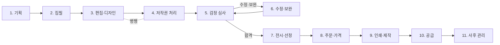
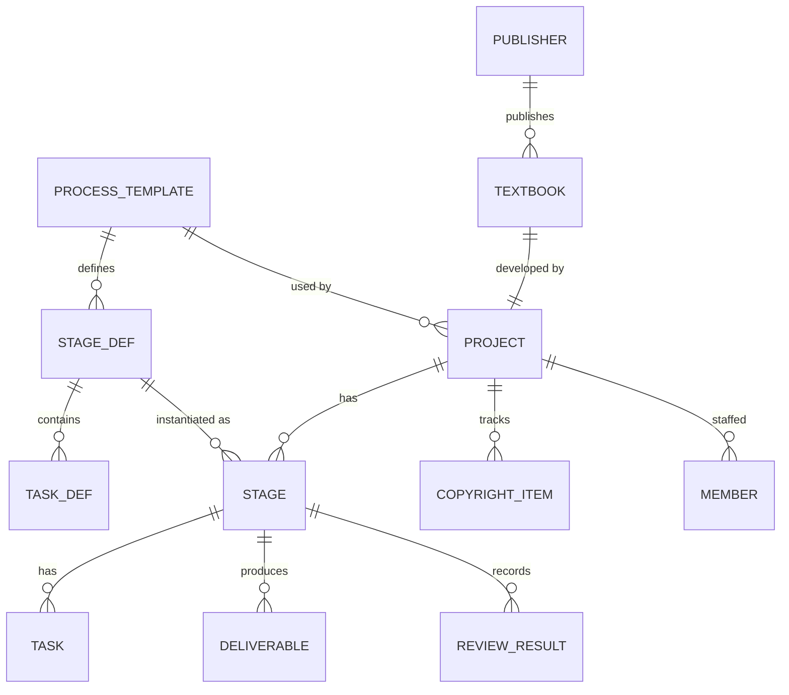

# 교과서 제작 공정 앱 설계

검인정 교과서 한 권이 기획부터 학교에 공급되고 사후 관리까지 거치는 전체 공정을 한눈에 보여주고, 교과서별로 현재 어느 단계에 있는지 추적하는 앱.

> 기관명, 일정, 심사 절차는 교육과정 개정 주기와 해마다 나오는 교육부 공고에 따라 달라진다. 앱에서는 이 값들을 코드에 고정하지 않고 **공정 템플릿 데이터**로 관리한다(아래 3장 참고).

---

## 1. 목표와 사용자

| 사용자 | 앱으로 하려는 일 |
|---|---|
| 경영진 / 사업 책임자 | 전체 교과서의 진행률, 지연 위험, 심사 결과를 한 화면에서 확인 |
| 개발 PM / 편집자 | 담당 교과서의 단계별 할 일, 마감일, 산출물 관리 |
| 저작권 담당 | 교과서별 이미지·텍스트 저작권 처리 현황과 사용 허락 계약 추적 |
| 신규 입사자 | 교과서 제작 공정 전체를 학습하는 참고 자료로 활용 |

**핵심 질문 세 가지에 답해야 한다**
1. 교과서는 어떤 순서로 만들어지는가? → 공정 맵
2. 우리 교과서는 지금 어디쯤 와 있는가? → 교과서별 진행 보드
3. 어디가 막혀 있거나 늦어지고 있는가? → 대시보드와 알림

---

## 2. 전체 공정 (기본 템플릿)

| # | 단계 | 주요 작업 | 산출물 | 게이트(다음 단계로 넘어가는 조건) |
|---|---|---|---|---|
| 1 | 기획 | 교육과정·집필 기준·검정 기준 분석, 집필진 구성, 개발 계획 수립 | 개발 계획서, 집필진 계약 | 내부 기획 승인 |
| 2 | 집필 | 단원 구성안, 견본 단원, 원고 집필, 내부 검토와 감수 | 원고, 감수 의견서 | 원고 확정 |
| 3 | 편집·디자인 | 편집, 삽화·사진 제작, 조판, 교정(1교~3교) | 조판 파일, 교정지 | 최종 교정 완료 |
| 4 | 저작권 처리 | 인용 텍스트·이미지 목록화, 사용 허락 확보, 출처 표기 | 저작권 목록, 허락서 | 미처리 항목 0건 |
| 5 | 검정 심사 | 심사본 제출, 기초 조사, 본심사 | 심사 결과 통보 | 합격 또는 조건부 합격 |
| 6 | 수정·보완 | 수정·보완 권고 사항 반영 후 재제출 | 수정 대조표 | 최종 합격 |
| 7 | 전시·선정 | 교과서 전시, 홍보, 학교별 선정 | 전시본, 홍보물 | 선정 기간 종료 |
| 8 | 주문·가격 | 주문 집계, 가격 신고와 결정 | 주문 수량, 확정 가격 | 수량·가격 확정 |
| 9 | 인쇄·제작 | 인쇄 파일 출력, 인쇄, 제본, 품질 검사 | 완성본 | 품질 검사 통과 |
| 10 | 공급 | 공급 기관·총판을 거쳐 학교로 배송 | 배송 완료 내역 | 공급 완료 |
| 11 | 사후 관리 | 오류 수정(정오표), 수정 요청 대응, 디지털 자료, 2차 활용 사용 허락 | 정오표, 사용 허락 계약 | 사용 기간 종료 |

- **검정 도서와 인정 도서**는 심사 주체와 절차가 다르므로 5~6단계를 별도 템플릿으로 둔다.
- **교사용 지도서, 평가 문항집, 디지털 자료** 같은 부속 산출물은 교과서에 딸린 "부속 트랙"으로 관리한다.

---

## 3. 데이터 모델

공정 정의(**템플릿**)와 실제 진행 기록(**인스턴스**)을 분리하는 것이 설계의 핵심이다. 제도가 바뀌면 템플릿만 수정하면 된다.

| 엔티티 | 주요 필드 |
|---|---|
| `Publisher` | 이름, 구분(자사/타사) |
| `Textbook` | 교과, 과목, 학교급, 학년, 교육과정 연도, 도서 구분(검정/인정), 발행사 |
| `ProcessTemplate` | 이름(예: "2022 개정 검정 도서"), 버전 |
| `StageDef` / `TaskDef` | 순서, 이름, 설명, 기본 소요 기간, 게이트 조건, 필수 산출물 |
| `Project` | 교과서, 템플릿, 시작일, 목표 공급일, 책임자 |
| `Stage` | 상태(`대기`/`진행`/`완료`/`보류`/`반려`), 계획 시작·종료일, 실제 시작·종료일 |
| `Task` | 담당자, 마감일, 완료 여부 |
| `Deliverable` | 종류, 파일 링크, 버전 |
| `ReviewResult` | 심사 차수, 결과(합격/조건부/불합격), 권고 사항 수 |
| `CopyrightItem` | 자료 유형(이미지/텍스트/음원), 출처, 권리자, 허락 상태, 사용료, 계약 기간 |
| `Member` | 역할(집필자/편집자/디자이너/저작권 담당/PM) |

**지연 판정 규칙**: 계획 종료일이 지났는데 `완료`가 아니면 *지연*, 남은 기간이 기본 소요 기간의 20% 미만이면 *위험*으로 표시한다.

---

## 4. 화면 구성

| 화면 | 내용 |
|---|---|
| **공정 맵** | 11단계를 가로 흐름도로 표시한다. 단계를 누르면 작업, 산출물, 게이트, 관련 기관 설명이 옆 패널에 뜬다. 학습용으로도 쓴다. |
| **교과서 목록** | 발행사, 교과, 학교급, 도서 구분으로 필터링한다. 각 행에 11칸짜리 진행 막대(단계별 색상)를 보여준다. |
| **교과서 상세** | 상단에 단계 스테퍼, 아래 탭에 일정(간트), 작업, 산출물, 심사 이력, 저작권, 참여자를 둔다. |
| **대시보드** | 단계별 교과서 수, 지연·위험 목록, 이번 달 마감 작업, 심사 결과 요약을 보여준다. |
| **저작권 현황** | 교과서 전체의 미처리 저작권 항목과 만료가 다가오는 사용 허락 계약을 모아 본다. |
| **템플릿 관리** | 관리자가 단계, 작업, 게이트를 편집한다. 새 템플릿 버전은 새 프로젝트에만 적용한다. |

---

## 5. 기술 구성 (제안)

| 영역 | 선택 | 이유 |
|---|---|---|
| 프런트엔드 | Next.js (React) + TypeScript | 목록, 상세, 대시보드 화면을 한 코드베이스로 구성 |
| UI | Tailwind CSS + shadcn/ui | 표, 탭, 패널 컴포넌트를 빠르게 구성 |
| 흐름도·간트 | React Flow, frappe-gantt | 공정 맵과 일정 시각화 |
| 데이터 | SQLite + Prisma (MVP) → PostgreSQL (운영) | 처음에는 설치 없이 시작하고 나중에 이전 |
| 인증 | 사내 계정 SSO 또는 이메일 로그인 | 역할별 권한(보기/편집/관리) |
| 초기 데이터 | 공정 템플릿 JSON 시드 파일 | 제도가 바뀌면 JSON만 수정 |

---

## 6. 단계별 개발 계획

| 단계 | 범위 | 완료 기준 |
|---|---|---|
| **MVP** | 공정 맵(읽기 전용), 교과서 목록·상세, 단계 상태 수동 변경, 시드 데이터 | 교과서 5종의 진행 상황을 앱에서 확인 가능 |
| **2차** | 작업·마감일, 지연 판정, 대시보드, 역할별 권한 | PM이 주간 보고를 앱 화면으로 대체 가능 |
| **3차** | 저작권 항목·사용 허락 계약 관리, 만료 알림 | 저작권 담당이 교과서별 처리 현황을 앱에서 관리 |
| **4차** | 발행사별 전체 교과서 목록(외부 공개 데이터 연동), 엑셀 가져오기·내보내기 | 타사 교과서까지 포함해 조회 가능 |

---

## 7. 결정이 필요한 사항

1. **대상 범위**: 자사 교과서만 관리할지, 타사 교과서 목록까지 함께 보여줄지 (4차와 연결)
2. **데이터 입력 방식**: 앱에서 직접 입력할지, 기존 엑셀·그룹웨어 데이터를 가져올지
3. **배포 형태**: 사내 서버 웹앱, 개인용 데스크톱 앱, 정적 페이지(읽기 전용) 중 선택
4. **공정 템플릿 검증**: 2장의 11단계를 실제 사내 업무 흐름과 맞춰 보고 단계 이름과 게이트를 확정
